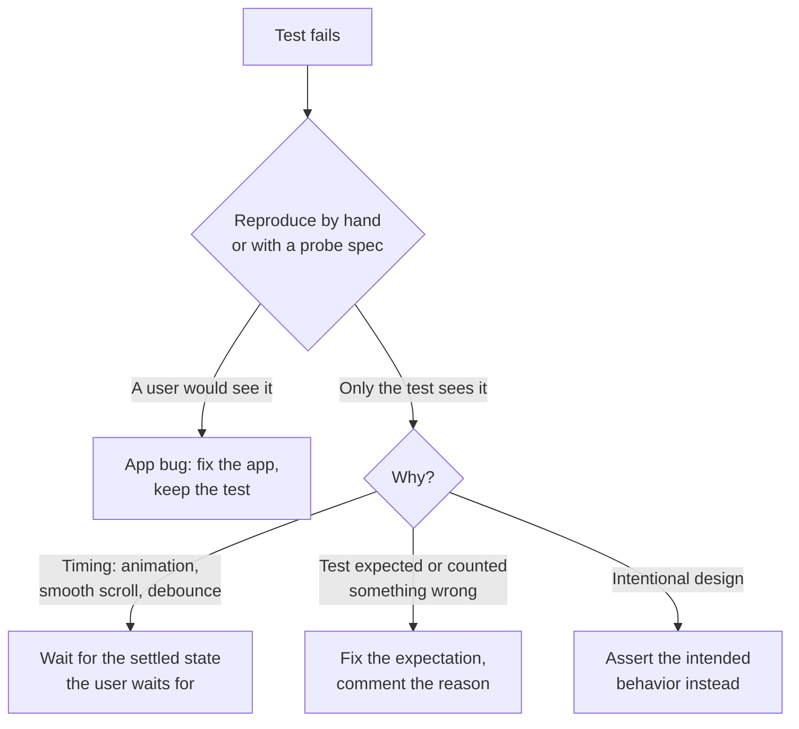

# ui-testing — test every piece of UI, and prove it

## Why this skill exists

"Write some UI tests" produces a few happy-path clicks that pass while most of the
UI stays untested — and nobody can say *which* part. The usual fixes don't answer it:
JS coverage measures code, not controls; a hand-written checklist only covers what
its author (often the same AI that wrote the app) thought of; a green run says
nothing when the assertions are hollow.

This skill makes coverage **measured against things the tests didn't choose**:

| Question | Denominator (not chosen by the tests) | Tool |
|---|---|---|
| Did tests touch every control? | every interactive element the **crawler** found on every route, plus every one any test saw on screen | `tools/ui-coverage.mjs` |
| Did tests reach every state? | the **state matrix**, started from a machine-generated draft; each cell must name a test that **passed** | `tools/ui-coverage.mjs` |
| Did tests run every code path? | every function in the app's own scripts | `tools/coverage-report.mjs` |
| Do the tests check anything? | every test body | `tools/lint-specs.mjs` |

`node tools/ui-gate.mjs` runs all four plus the suite and writes `UI-COVERAGE.md`.
Read `references/coverage-model.md` once to know exactly what "100%" does and does not mean.

## The seven layers

| # | Layer | Catches | Tool |
|---|---|---|---|
| 1 | **Deterministic fixtures** | nothing by itself; makes everything repeatable and free | pinned date, captured API snapshot, route mocks |
| 2 | **Behavior tests** | broken interactions | one Playwright test per interaction |
| 3 | **State matrix** | states nobody built or tested | `state-matrix.md` + mocks that force each state |
| 4 | **Visual regression** | the "border came out the wrong colour" class | `toHaveScreenshot` per theme × viewport |
| 5 | **Accessibility + keyboard** | contrast, labels, unreachable controls, missing focus rings | `@axe-core/playwright` + a Tab walk |
| 6 | **Measured coverage** | controls, states and code no test reached | the gate |
| 7 | **Strict console** | silent runtime errors | fixture fails any test with a console error |

Principles across all layers:

- **Assert what a user would notice**: visible text, what is highlighted (`aria-current`), expanded (`aria-expanded`) *and actually visible*, disabled, focused; whether the page scrolls sideways. Not internal state or meaningless class names.
- **Mock at the network boundary.** The app runs for real; only API responses are faked. That reaches states a real backend rarely produces (slow, 500, empty, 10,000 rows, hostile HTML) without touching app code.
- **A few real round-trips.** One serial spec against the real (offline, credential-free) backend proves the mocks match reality.

## Workflow

Copy this checklist and tick it off:

```
- [ ] 1. Scaffold e2e/ and configure it
- [ ] 2. Deterministic fixtures (pinned date, snapshot, offline backend)
- [ ] 3. Crawl → inventory → draft the state matrix
- [ ] 4. Write specs, layer by layer
- [ ] 5. Run the gate → triage every failure (app bug vs test bug)
- [ ] 6. Coverage loop until the gate's lists are empty or reasoned
- [ ] 7. Ship gate: node tools/ui-gate.mjs --runs=3
```

### 1. Scaffold

Run `node <skill>/scripts/scaffold.mjs <project-dir>` (Windows, macOS, Linux). It creates `e2e/` — config, fixtures, crawler, probe, the four tools, matrix template — and installs `@playwright/test` and `@axe-core/playwright`. It never overwrites files. Requirements: Node 20+, Google Chrome (`channel: "chrome"` avoids downloading browsers).

Then edit the marked values:
- `playwright.config.ts`: `PORT`, `webServer.command` (start the app in its deterministic mode), `APP_SCRIPT_MATCH` (regex for the app's own script URLs — `/static/` for a bundle, `/src/` for a Vite dev server).
- `tests/fixtures.ts`: `DEFAULT_SNAPSHOT`, `READY_SELECTOR`, `SETTLED` (true once entrance animations finish).
- `tests/inventory.crawl.ts`: `prepare()` — the mocks for the realistic populated state.
- `ui-coverage.json`: `crawl.routes` (entry points; links are followed), `crawl.skipRoutes` (logout etc.), `collections` (see step 3).

### 2. Deterministic fixtures

You **MUST** remove every source of non-determinism before the first assertion, because a test that depends on today's date, live data or a paid API will flake or cost money:

1. **Pin the clock**: an app-level "today" override (`APP_TODAY=YYYY-MM-DD`) or `page.clock.setFixedTime()` for client-only dates.
2. **Capture one realistic snapshot** of the main API payload from a real run into `e2e/fixtures/`. Real content exposes layout bugs lorem ipsum hides.
3. **Offline backend**: if the app calls paid services (LLMs, payments), the test server **MUST** use a fake provider.
4. **Mocks per state**: each test clones the snapshot and mutates it (`d.items = []`, a 200-char title, `status: 500`, `delayMs: 1500`) via `mockApi()`; background jobs via `mockJob()`.

### 3. Crawl → inventory → draft matrix

Run `node tools/ui-gate.mjs` once with no specs yet (it will fail — that's expected). The crawler opens every route, follows same-origin links, clicks each control once in a fresh page to reveal menus, dialogs and tabs (all non-GET requests are aborted), and writes `.ui-inventory.json`. Then:

```bash
node tools/ui-coverage.mjs --draft-matrix   # → state-matrix.draft.md, one row per control found
```

You **MUST** build `state-matrix.md` from that draft, because a matrix written from memory lists only what its author thought of. Merge control rows into groups where it helps, add one row per data region (empty / loading / error / populated / edge), and never drop a row just because it is inconvenient.

If the report shows a hint "possible data-driven lists", add the row selector (e.g. `"#items > li"`) to `collections` in `ui-coverage.json`, so one test on one row covers the row link instead of 40 "untested" links. Buttons inside rows keep their labels ("Edit" and "Delete" stay two controls).

### 4. Write the specs

One spec file per layer, in this order. Copy-ready patterns are in `references/layer-patterns.md`; load it now.

| Spec | Must contain |
|---|---|
| `states.spec.ts` | every region cell: populated, empty, slow-load skeleton, no flash on fast load, error + retry, long text (truncates, no sideways scroll), huge numbers, hostile HTML (shown as text, never run), missing optional fields, non-JSON error bodies |
| `interactions.spec.ts` | every control: its effect, its request body, its busy/locked state (hold the request open), its failure (message shown, control unlocks), validation that blocks the request |
| `navigation.spec.ts` | each nav item highlights exactly itself, deep links, back links, 404s, dialogs open/cancel/confirm, external links (`rel=noopener`, intercepted so the test stays offline) |
| `theme-a11y.spec.ts` | default theme on both OS settings, toggle persists, axe per theme × screen × expanded state, Tab walk with a visible focus ring on every stop, reduced motion |
| `visual.spec.ts` | full page per theme × viewport, key panels in interesting states |
| `flows.spec.ts` | serial, desktop only: a few real round-trips + server guards |

Tag specs that matter on small screens `@responsive`; the mobile project runs only those. Matrix references may omit the tags.

### 5. Run the gate → triage

```bash
cd e2e
npx playwright test --update-snapshots   # first run only: create visual baselines
node tools/ui-gate.mjs                   # lint → crawl → run → JS + UI coverage + matrix
```

For every failure you **MUST** decide which side is wrong before changing anything, because "fixing" a test to match a real bug hides the bug:



Debug with a throwaway probe spec that prints measurements, then delete it. Real examples of each branch, including three app bugs the demo suite caught, are in `references/triage-examples.md`.

### 6. Coverage loop

The gate prints, per route, every element no test interacted with and where it was found (`crawl (after clicking …)` tells you how to reach it); every function and code span no test ran; every matrix cell that is empty, names a missing test, or names a test that failed. For each item: write the test, or record why it can't happen — `n/a: <reason>` in the matrix, or an `ignore` rule with a `reason` in `ui-coverage.json`. Repeat until the lists are empty or reasoned. Uncovered spots are where bugs hide.

### 7. Ship gate

You **MUST** run `node tools/ui-gate.mjs --runs=3` and see it pass before reporting done, because one green run doesn't prove a suite is stable, and because the gate — not your own reading of the suite — is the evidence. Report the `UI-COVERAGE.md` summary table to the user, including every `n/a` and `ignore` you added.

## Rules that keep the numbers honest

- You **MUST NOT** add an `ignore` rule, an `n/a` cell, a `// skip-ok:` or a `// force-ok:` to make the gate pass without a reason a reviewer can check, because each one removes UI from the denominator. Tell the user about every one you add.
- You **MUST NOT** lower `thresholds` in `ui-coverage.json` or delete matrix rows to pass the gate. If 100% UI coverage is genuinely wrong for a project, say so to the user and let them change it.
- Every interaction in a test **MUST** be followed by an assertion of its effect, because the UI metric counts interactions: a click with nothing checked afterwards inflates coverage without testing anything. The linter only catches tests with no assertion at all.
- You **MUST NOT** use fixed sleeps to wait for app behavior — use web-first assertions (`toBeVisible`, `expect.poll`), because sleeps are flaky or slow. The exception is a human-paced pause the test simulates (letting a smooth scroll finish); comment it.
- Screenshots and axe scans **MUST** run on the settled UI. Wait in the shared `open()` helper, not in each test.
- Prefer role/label locators (`getByRole("button", { name, exact: true })`): they also prove the control is accessible. Use `exact: true` when one name contains another ("Read" / "Mark unread").
- Assert visibility, not just ARIA: an `aria-expanded="false"` panel that a CSS rule keeps on screen is a real bug the demo shipped with.
- You **MUST NOT** update visual baselines to make a failure go away without looking at the diff image. Baselines change only with an intended design change.
- A test that deliberately triggers a 4xx/5xx **MUST** opt out of the strict console explicitly (`allowConsoleErrors(testInfo)`).
- Use the fixtures' `reload(page)`, never `page.reload()`: Chrome drops a page's JS coverage on navigation.

## Common mistakes

| Mistake | Fix |
|---|---|
| Writing the matrix from memory | Start from `--draft-matrix`; the crawler and the tests saw more than you remember |
| Counting focusables with `offsetParent !== null` | Closed `<details>` content keeps a layout box but isn't tabbable; exclude `details:not([open]) *` except `summary` |
| Tab-walk key `tag + text` | Rows repeat button text; add the element's position to the key |
| axe or screenshot right after `goto` | Wait for the entrance animation in `open()` |
| Wheel/keyboard scroll right after a click that smooth-scrolls | The browser finishes the programmatic scroll; wait as a person would |
| Busy asserted as `cursor: not-allowed` | Busy and disabled are different states; assert each one's intended style |
| One shared server for parallel tests that mutate state | Mutating specs run `serial`; everything else mocks the API |
| macOS baselines compared on Linux CI | Baselines are per-OS; generate them in the CI image |
| Coverage of vendor bundles | Narrow `APP_SCRIPT_MATCH` to the app's own scripts |
| Data rows reported as 40 untested links | Add the row selector to `collections` |
| A control only some states render (Try again, empty-state CTA) missing from the inventory | Expected: the crawler sees the populated state; the tests that force the state add it to the denominator automatically |

## Ship gate checklist

- [ ] `node tools/ui-gate.mjs --runs=3` passes
- [ ] Every `n/a`, `ignore` rule and `skip-ok`/`force-ok` comment has a checkable reason, and the user has been told
- [ ] No "clickable without a role" warnings, or each one is a reported a11y issue
- [ ] axe: zero WCAG 2.1 AA violations in every theme and screen
- [ ] Visual baselines for each theme × viewport, reviewed by eye once
- [ ] The project README says how to run the suite, update baselines and read `UI-COVERAGE.md`

## Scope

- Browser-level testing of web UIs with Playwright. Building or styling the UI is out of scope; backend unit tests stay in the project's own runner.
- Canvas/WebGL content, drag-and-drop targets and hover-only menus are not inventoried as controls; cover them with explicit matrix rows.

## Files

| File | Use |
|---|---|
| `scripts/scaffold.mjs` | create `e2e/` in a project and install dependencies |
| `scripts/ui-gate.mjs` | lint → crawl → run ×N → coverage → `UI-COVERAGE.md`; exit 0 only if all pass |
| `scripts/ui-coverage.mjs` | UI element coverage, state-matrix verification, `--draft-matrix` |
| `scripts/coverage-report.mjs` | merged V8 JS coverage: %, functions and code never run |
| `scripts/lint-specs.mjs` | hollow-test linter (rules in its header) |
| `assets/ui-probe.js` | in-page probe shared by crawler and fixtures: element keys, interaction capture |
| `assets/inventory.crawl.ts` | the crawler, run as its own Playwright project |
| `assets/fixtures.ts` | strict console, JS + UI coverage capture, `mockApi`, `mockJob`, `open`, `reload` |
| `assets/playwright.config.ts` | desktop + mobile projects, json results, inventory project, Chrome channel |
| `assets/ui-coverage.json` | thresholds, crawl settings, collections, ignore rules with reasons |
| `assets/state-matrix.md` | matrix template and cell format |
| `references/coverage-model.md` | exactly how elements are keyed and counted; limits; fixing key mismatches |
| `references/layer-patterns.md` | copy-ready test patterns for every layer |
| `references/triage-examples.md` | real failures, which side was wrong, and the fix |
